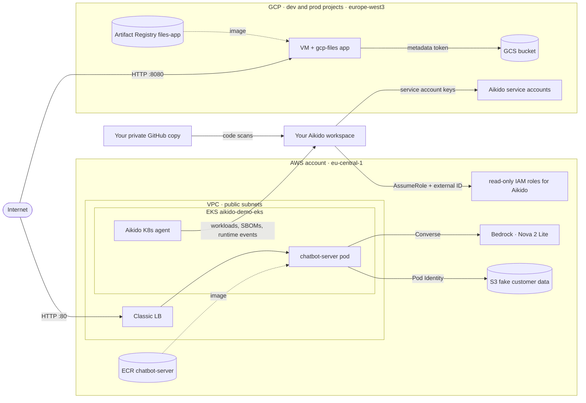

# Aikido Security from code to cloud on AWS and GCP

A deliberately vulnerable environment for trying out [Aikido Security](https://www.aikido.dev) across every layer it scans. It includes a payments chatbot ("PayBuddy") on EKS that reads fake customer data from S3 through Amazon Bedrock, and a small file viewer on a GCP VM, deployed into a dev and a prod project. Code, dependencies, container images, Terraform, Helm, cloud posture and VM packages are all misconfigured on purpose. One command deploys the environment and connects it to **your own** Aikido workspace, a second command shows what Aikido found, and a third removes it all again.

> Companion post: [Aikido Security, hands-on: from code to cloud on AWS and GCP](TBD)

> **Deliberately insecure and internet-exposed.** Use fake data only, and only in accounts you are happy to expose for a short while. The chatbot and both file viewers are public. Strangers can reach them, and they can spend your Bedrock budget. Keep the environment up only while you evaluate, then run `make destroy`. Every planted flaw carries an `INSECURE-BY-DESIGN:` comment in the source.
>
> **Cost while up:** about $0.25 per hour on AWS (EKS control plane, 2× t3.medium, a classic load balancer) plus about $1 per day for the two GCP projects. Bedrock is billed per use.

Tested on an Aikido **Pro Trial** workspace.

## Prerequisites

- **Tools:** `aws` CLI v2, `terraform` ≥ 1.16, `helm` v4, `kubectl`, `docker` with `buildx`, `node`/`npm` (Node 22+), `jq`, `curl`, `gcloud`, `git`, `gh` (optional, to create your private repo), `make`. For `make test`, also `bats`, `shellcheck` and `python3`. The deploy checks for these first.
- **AWS:** an account you can deploy into, with the AWS CLI logged in and the region set to `eu-central-1` (the scripts refuse any other region unless `ALLOW_ANY_REGION=1`). Bedrock must be able to invoke the inference profile `eu.amazon.nova-2-lite-v1:0` there. Amazon's own models need no use-case form.
- **GCP:** an **organization** (the lab creates two projects under it), a billing account, and `gcloud auth application-default login`. Your Google account needs permission to create projects in the organization and `roles/orgpolicy.policyAdmin` on it, because the lab overrides three org policies on its own two projects (see [How it works](#how-it-works)). If an org admin has to grant the role:
  ```bash
  gcloud organizations add-iam-policy-binding <your org id> \
    --member=user:<you> --role=roles/orgpolicy.policyAdmin
  ```
- **GitHub:** an account for a **private** copy of this lab. Aikido scans that copy, not this public repository.
- **Aikido:** a workspace connected to your GitHub account (signing in with GitHub is enough).

## Bring your own Aikido workspace and cloud settings

Nothing in this lab points at a particular account. Two files hold your values, and both are gitignored:

| Value | Where to get it | Where it goes |
|---|---|---|
| `AIKIDO_CLIENT_ID`, `AIKIDO_CLIENT_SECRET` | Aikido: **Settings → Integrations → API → REST API**. Create a client with the scopes `clouds:read`, `clouds:write`, `repositories:read`, `repositories:write`, `issues:read` | `.env` |
| `AIKIDO_REPO_NAME` | The name of your private copy, which `make repo` prints | `.env` |
| `AIKIDO_EXTERNAL_ID` (optional) | Leave it empty. The deploy derives it as `aikido-<workspace id>` from the Aikido API. Set it only if Aikido's AWS connect wizard shows a different value | `.env` |
| `gcp_org_id` | `gcloud organizations list` | `infra/terraform.tfvars` |
| `gcp_billing_account` | `gcloud billing accounts list` | `infra/terraform.tfvars` |
| `gcp_own_customer_id` | `gcloud organizations describe <gcp_org_id> --format='value(owner.directoryCustomerId)'` | `infra/terraform.tfvars` |

These are Aikido's own values, kept as defaults in `infra/01_variables.tf`. Change them only if Aikido's connect wizards show something else: the principal ARNs Aikido uses to assume the read-only AWS roles (`aikido_principal_arn`, `aikido_vm_principal_arn`, `aikido_ecr_principal_arn`) and Aikido's Cloud Identity customer ID `C016qe815` (`gcp_aikido_customer_id`), which the GCP org-policy override allows.

## Run it

```bash
# 1. Make your private copy (outside this checkout). It gets freshly generated fake secrets.
make repo DEST=$HOME/aikido-lab GH_REPO=<you>/aikido-lab
cd $HOME/aikido-lab

# 2. In Aikido, connect the new repository (Repositories → add repository).

# 3. Fill in your settings.
cp .env.example .env                                     # Aikido client + AIKIDO_REPO_NAME
cp infra/terraform.tfvars.example infra/terraform.tfvars  # GCP organization, billing, customer id

# 4. Deploy AWS + GCP and connect everything to Aikido (15–20 minutes from scratch).
make deploy            # asks once; YES=1 skips the prompt

# 5. After the manual steps below, wait for the scans and take a snapshot of the findings.
make findings
```

If you leave out `GH_REPO`, `make repo` only creates the local repository and prints the `gh repo create … --private` command to run yourself. `make deploy ARGS="--skip-image --skip-seed"` reruns a deploy quickly against an existing environment (`--skip-infra` skips Terraform too).

### Manual steps in the Aikido UI

The Aikido API has no endpoint for these, so the deploy can't do them for you:

- **VM scanning, once per GCP project:** **Virtual Machines → Connect VMs → Google Cloud**, once for the dev project and once for the prod project.
- **Threat detection for the EKS cluster:** open the `aikido-demo-eks` cluster's settings and turn on **threat detection**. Detections then show up under **Runtime Sensors → Detections**.
- **AWS VM (EBS) scanning and the ECR registry:** the deploy connects only the AWS cloud-posture role. Terraform also creates a read-only role for each of these two, and you paste their ARNs into Aikido's VM-scanning and container-registry wizards. All three roles use the same external ID (`aikido-<workspace id>`):
  ```bash
  terraform -chdir=infra output -raw aikido_vm_role_arn
  terraform -chdir=infra output -raw aikido_ecr_role_arn
  ```

## What you should see

The deploy ends with a summary: the chatbot URL, the IDs of the Aikido clouds it created, and both GCP file-viewer addresses. Its last line is `URL: http://<load balancer>`.

- Open the URL and log in as **`alice` / `alice123`**. Ask "What are my recent payments?" or "Set up a monthly payment of €50 to Electricity Co". The other fake customers are in `apps/server/src/data/users.json`.
- The file viewers answer on `http://<vm ip>:8080` (`terraform -chdir=infra output gcp` lists them).
- In Aikido, the clouds `aikido-demo-aws`, `aikido-demo-eks`, `aikido-demo-gcp-dev` (environment *development*) and `aikido-demo-gcp-prod` (environment *production*) appear within minutes. The repository scan, the cloud posture checks, container images and, after the manual step, VM disks fill in over the following minutes to hours.
- `make findings` saves every open issue to `.state/findings-<UTC time>.json` and prints one row per issue type. Each row has its count per severity and `first_seen_min`, the minutes from the deploy to the first detection of that type. A negative value means Aikido already knew the finding before this deploy (code findings survive a destroy). Run it again later to see new scans arrive.

Things worth comparing in the UI: the same GCP misconfiguration in dev and in prod, and the public VM in prod against its internal-only twin.

## How it works



| Part | Where |
|---|---|
| Terraform (`aws-env` and `gcp-env` modules; numbered files = dependency order) | [`infra/`](infra/README.md) |
| Chatbot server, Dockerfile, Helm chart | [`apps/server/`](apps/server/README.md) |
| Aikido Kubernetes agent wrapper chart | [`apps/aikido-k8s/helm/`](apps/aikido-k8s/helm/README.md) |
| GCP file viewer (Flask app and Dockerfile) | [`apps/gcp-files/`](apps/gcp-files/README.md) |
| Deploy, findings, destroy and copy scripts | `scripts/` |

**AWS half.** A VPC with public subnets only (no NAT gateway), an EKS cluster and the PayBuddy chatbot: TypeScript/Express with a LangChain agent on Bedrock Nova 2 Lite. It runs behind a classic load balancer and reads fake customer data from S3 through EKS Pod Identity. The image lives in ECR. Terraform also creates three read-only IAM roles that Aikido assumes with your workspace's external ID: one for cloud posture, one for scanning VM disks and one for reading ECR. The deploy installs Aikido's Kubernetes agent through a small wrapper chart (pinned `kubernetes-agent` 2.16.1) with runtime detection on. That adds a Falco DaemonSet that only detects: nothing is blocked or killed.

**GCP half.** One Terraform module, instantiated twice: a dev and a prod project, identical apart from names and the environment label. Each has a VM that runs the Flask file viewer on port 8080 (it serves objects from a GCS bucket using the VM's metadata token), an Artifact Registry, a bucket with generated fake data, and two service accounts for Aikido (cloud posture and registry). Prod also gets an internal-only twin of the VM, with the same packages but no public IP, so you can see whether Aikido ranks exposure. Because organizations often block what the lab needs, Terraform overrides three org policies **on the two lab projects only**, never on the organization:
- `iam.allowedPolicyMemberDomains`, extended with Aikido's customer ID so its scanner accounts can be granted access
- `iam.managed.disableServiceAccountKeyCreation`, so the Aikido service account keys can be created
- `storage.uniformBucketLevelAccess`, so the bucket can keep per-object ACLs (one of the planted flaws)

The overrides take a while to propagate, so Terraform waits 90 seconds after setting them. If the first apply still hits a constraint violation, rerun `make deploy`.

**Connecting to Aikido.** `scripts/lib/aikido.sh` talks to Aikido's REST API with your client credentials. It connects the AWS account, creates the Kubernetes cloud (whose one-time token goes straight into the agent's Helm release), connects both GCP projects and their registries with the right environment, and triggers a scan of your repository. The cloud and registry IDs are kept in `.state/aikido.json`. Secrets are never written to disk. A rerun reuses the existing clouds and releases. What stays manual is listed above, along with a few more steps under [Clean up](#clean-up). That gap is part of what the lab shows.

**Fake secrets.** This public lab contains only `__FAKE_…__` placeholders. `make repo` copies the tracked files into a new repository and replaces each placeholder with a random value in a realistic format (an AWS key pair, Stripe live keys, a Slack webhook, an internal API key, a JWT secret), so Aikido's secret scanning has something to find in your copy. None of these values work anywhere. Each copy gets new ones.

## Clean up

**First, in the Aikido UI,** remove the AWS VM-scanning and ECR integrations you added by hand, so Aikido stops scanning before its roles disappear. Then:

```bash
make destroy           # asks once; YES=1 skips the prompt (about 7 minutes)
```

It uninstalls the chatbot and waits until its load balancer is really gone, removes the agent, and deletes the `aikido-demo-*` Aikido clouds. It never touches clouds with other names. It then runs `terraform destroy` for AWS and both GCP projects, clears `.state/`, and prints a leftover report: AWS resources tagged `Project=aikido-demo`, `aikido-demo-*` clouds, and active lab GCP projects. Every step tolerates "already gone", and you can rerun it at any time, including after a failed deploy.

Some things are left for you, because the API can't do them:
- **A cloud that still has VM scanning enabled** can't be deleted via the API. The destroy prints its ID; delete it in the Aikido UI.
- **The GCP Artifact Registry registries in Aikido** can't be listed or deleted via the API. The destroy prints their IDs; remove them under Containers in the UI. Once a project is gone, its registry key stops working anyway.
- **EBS snapshots Aikido left behind** while scanning VM disks. They are tagged `aikido_snapshot=true`, not `Project=aikido-demo`, so the leftover report misses them, and they keep costing money:
  ```bash
  aws ec2 describe-snapshots --owner-ids self --filters Name=tag:aikido_snapshot,Values=true \
    --query 'Snapshots[].SnapshotId' --output text
  ```
- **Your private copy** on GitHub: delete it, or disconnect it in Aikido, when you're done.

## Tests

```bash
make test
```

This runs shellcheck and bats for the scripts (including the `make repo` checks), the Helm chart checks, the server's vitest suite, the file viewer's pytest suite, and `terraform fmt`, `validate` and `test`. Nothing is deployed, but the Terraform plans of the AWS module read your account, so `terraform test` needs a valid AWS login.

## Troubleshooting

| Symptom | Fix |
|---|---|
| `missing …/infra/terraform.tfvars` or `missing environment variables: AIKIDO_REPO_NAME` | Step 3 of [Run it](#run-it) isn't done yet. |
| `make repo` refuses the destination | Pick an empty folder outside this checkout, e.g. `DEST=$HOME/aikido-lab`. |
| `AWS connect failed` with a 4xx | The deploy already retries for 2 minutes to allow for IAM propagation. If it still fails, the external ID is wrong: check Aikido's AWS connect wizard and set `AIKIDO_EXTERNAL_ID` in `.env`. |
| `terraform apply` fails on an org policy or permission error for the GCP projects | You need `roles/orgpolicy.policyAdmin` on your organization (see Prerequisites). If it's only a constraint violation right after the policies were set, rerun `make deploy`: the override needed time to propagate. |
| `make deploy` stops with a missing `gcloud` or no application-default credentials | Install `gcloud` and run `gcloud auth application-default login`. |
| Destroy waits on the load balancer, or `terraform destroy` hangs on the VPC, subnets or security groups | The load balancer Kubernetes created is still there. Rerun `make destroy`; it matches load balancers by VPC ID. |
| Chat answers with a Bedrock `AccessDeniedException` | Your account can't invoke `eu.amazon.nova-2-lite-v1:0` in `eu-central-1`. |
| Image build is slow, or fails with `exec format error` on Apple Silicon | The build always uses `--platform linux/amd64` (the nodes are x86). Make sure Docker Desktop has emulation enabled. |
| `kubectl` talks to the wrong cluster | `export KUBECONFIG=$PWD/.state/kubeconfig` (the deploy never touches `~/.kube/config`). |
| Repo scan warning: `A scan has been initiated in the last 2 minutes` | That's Aikido's rate limit; the earlier scan is enough. |
| You want a different value than the one in `.env` for one run | Variables set in the shell win over `.env`, e.g. `AIKIDO_EXTERNAL_ID=aikido-123456 make deploy`. |
