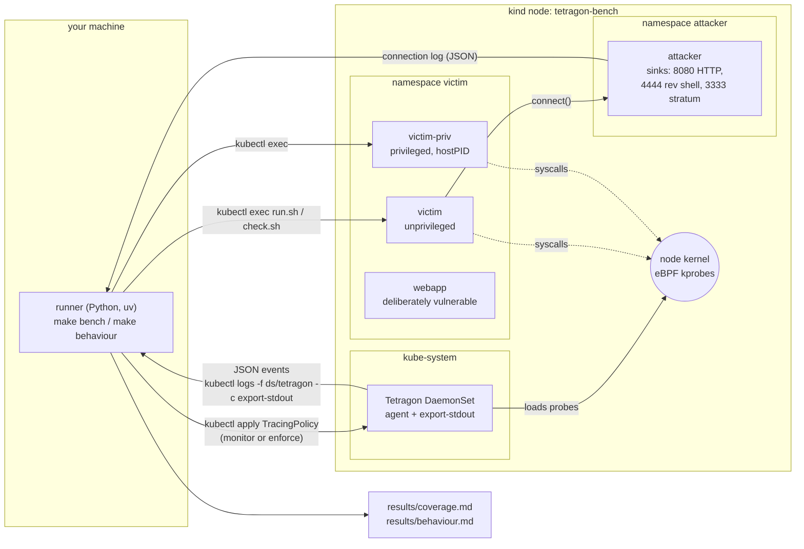

# Put Tetragon through a runtime-security benchmark on kind

Image scanners and admission policies decide what is allowed to *start*.
Runtime security watches what a workload *does* once it runs: which
binaries it execs, which files it opens, which syscalls it makes, where it
connects. [Tetragon](https://tetragon.io/) is Cilium's eBPF runtime-security
agent. It hooks the kernel (kprobes, tracepoints, LSM hooks), filters events
in the kernel, and can kill a process or fail a syscall before the call
returns.

This lab puts Tetragon v1.8.0 on a local kind cluster and runs 15
MITRE ATT&CK-mapped attack scenarios and 3 benign ones inside victim pods.
Each scenario runs under three **profiles**:

- `default`: Tetragon exactly as Helm installs it, with no policies. You get
  `process_exec` / `process_exit` events and nothing else.
- `tuned`: the lab's TracingPolicies loaded in **monitor** mode. They emit
  events but never act.
- `enforce`: the *same* policy files switched to **enforce** mode, so their
  Sigkill and Override actions are live.

A Python runner reads Tetragon's JSON event stream and turns it into a
coverage matrix: detected / missed / blocked per scenario and profile,
median detection latency, and false positives from the benign scenarios.
Three behaviour demos follow: process lineage, a stateful two-step
sequence, and Sigkill versus Override on the same syscall.

Everything stays inside the cluster. No workload has internet egress, the
"attacker" is a pod in the same cluster, and every fake secret says
`LAB-CANARY-NOT-A-SECRET`.

## Contents
- [Prerequisites](#prerequisites)
- [Run it](#run-it)
- [What you should see](#what-you-should-see)
  - [Reading coverage.md](#reading-coveragemd)
- [How it works](#how-it-works)
  - [Architecture](#architecture)
  - [One policy file, three profiles](#one-policy-file-three-profiles)
  - [How a run is scored](#how-a-run-is-scored)
  - [Scenarios and the hook each policy uses](#scenarios-and-the-hook-each-policy-uses)
  - [Policy notes](#policy-notes)
  - [What "happened" means for the kernel-module and BPF scenarios](#what-happened-means-for-the-kernel-module-and-bpf-scenarios)
- [Behaviour demos](#behaviour-demos)
- [Kernel features](#kernel-features)
- [The honest limits](#the-honest-limits)
- [SAFETY](#safety)
- [Out of scope](#out-of-scope)
- [Credits and further reading](#credits-and-further-reading)
- [Clean up](#clean-up)

## Prerequisites

| Tool | Version |
|------|---------|
| Docker | running daemon (Docker Desktop or Docker Engine) |
| [kind](https://kind.sigs.k8s.io/) | v0.32.0 (node image `kindest/node:v1.36.1`, pinned by digest) |
| kubectl | 1.36 |
| helm | v3.x or v4.x |
| [uv](https://docs.astral.sh/uv/) | 0.9+ (fetches Python 3.12 for the runner) |
| make, bash | any recent version |

The lab was tested on Docker Desktop on arm64 (Apple Silicon). The scripts
also carry the amd64 syscall numbers, but amd64 has not been run. The node
kernel needs BTF (`/sys/kernel/btf/vmlinux`), which Docker Desktop's kernel
has. See
[Kernel features](#kernel-features) for what else the kernel must offer.

The cluster is called `tetragon-bench`. Every `kubectl` and `helm` call pins
the `kind-tetragon-bench` context, and `make` puts your previous current
context back after kind creates or deletes the cluster.

## Run it

```bash
make up         # kind cluster, Tetragon 1.8.0, victim/attacker/webapp pods, canary check
make bench      # all scenarios x all profiles, RUNS=3 each -> results/coverage.md
make behaviour  # lineage, stateful and Sigkill-vs-Override demos -> results/behaviour.md
```

Or run all three in one go, from a cold start:

```bash
make e2e        # up + bench + behaviour; exits non-zero if any assertion fails
```

`make up` builds three small images, loads them into kind, installs the
`cilium/tetragon` 1.8.0 chart with [`infra/tetragon-values.yaml`](infra/tetragon-values.yaml),
deploys the pods, prints `tetra status`, and finishes with a canary: it
execs a binary in the victim pod and waits for the matching `process_exec`
event. If you see `Running canary succeeded.`, events are flowing.

A full `make bench` takes a while (18 scenarios x 3 profiles x 3 runs, plus a
5 s detection window each). To iterate on one scenario:

```bash
cd runner
uv run app bench --runs 1 --profiles tuned,enforce --only 06
```

`--only` takes comma-separated id prefixes; `--window` changes the
detection window (default 5 s).

`make test` lints, type-checks and unit-tests the runner (ruff, mypy
--strict, pytest, deptry). It does not need a cluster.

## What you should see

`make bench` prints the matrix and writes `results/coverage.md` and
`results/coverage.json`. The committed
[`results/example-coverage.md`](results/example-coverage.md) is the output
of a full `make e2e` run on Docker Desktop (arm64, kernel 6.10.14-linuxkit):

| # | Technique | Scenario | Tactic | default | tuned | enforce | median latency (tuned) |
|---|---|---|---|---|---|---|---|
| 01 | T1059.004 | Shell spawned by a Python process | Execution | missed | detected 3/3 | blocked 3/3 | 18 ms |
| 02 | T1105 | Download a tool to /tmp and run it | Command and Control | detected 3/3 | detected 3/3 | blocked 3/3 | 1 ms |
| 03 | T1620 | Fileless exec from a memfd | Defense Evasion | detected 3/3 | detected 3/3 | blocked 3/3 | 8 ms |
| 04 | T1053.003 | Write a cron job to /etc/cron.d | Persistence | missed | detected 3/3 | blocked 3/3 | 0 ms |
| 05 | T1098.004 | Append a key to root's authorized_keys | Persistence | missed | detected 3/3 | blocked 3/3 | 0 ms |
| 06 | T1548.001 | Set the setuid bit on a copied binary | Privilege Escalation | missed | detected 3/3 | blocked 3/3 | 1 ms |
| 07 | T1611 | Enter the host's mount namespace with nsenter | Privilege Escalation | detected 3/3 | detected 3/3 | blocked 3/3 | 1 ms |
| 08 | T1547.006 | Load a kernel module | Persistence | missed | detected 3/3 | blocked 3/3 | 0 ms |
| 09 | T1070.004 | Delete an application audit log | Defense Evasion | missed | detected 3/3 | blocked 3/3 | 1 ms |
| 10 | T1562.001 | Load an eBPF program | Defense Evasion | missed | detected 3/3 | blocked 3/3 | 1 ms |
| 11 | T1003.008 | Read /etc/shadow | Credential Access | missed | detected 3/3 | blocked 3/3 | 1 ms |
| 12 | T1552.001 | Read the service-account token | Credential Access | missed | detected 3/3 | blocked 3/3 | 1 ms |
| 13 | T1613 | Query the Kubernetes API with the pod's token | Discovery | missed | detected 3/3 | blocked 3/3 | 9 ms |
| 14 | T1571 | Reverse shell to the attacker on port 4444 | Command and Control | missed | detected 3/3 | blocked 3/3 | 31 ms |
| 15 | T1496 | Cryptominer stratum beacon to port 3333 | Impact | missed | detected 3/3 | blocked 3/3 | 14 ms |

False positives on b1–b3: none. Recall: default 3/15, tuned 15/15, enforce 15/15 blocked. Failures: none.

The short version: **the default install sees 3 of 15 attack scenarios, the
tuned policies see 15 of 15, and the same files in enforce mode block all 15, with no
false positives on the three benign scenarios.**

The three that default Tetragon catches are the ones that exec something
unusual: a binary from `/tmp` (02), an exec from a memfd (03, which
shows up as `/dev/fd/3`) and `nsenter` (07). Everything else either execs
nothing new (a Python process opening `/etc/shadow`), or execs something
ordinary (`cat`, `rm`, `chmod`) whose meaning is in its arguments. Execs
alone cannot see that.

### Reading coverage.md

- **default / tuned columns:** `detected k/n` means at least one of the
  scenario's signals (an exec matcher or a lab-policy kprobe event) fired in
  the pod within the window in `k` of `n` runs. `missed` means it never did.
- **enforce column:** `blocked k/n` needs both an enforcement event
  (Sigkill or Override, from a policy in enforce mode) **and** the
  scenario's check confirming the side effect did not happen. An
  enforcement event plus a side effect that still happened counts as
  `detected`, not blocked.
- **median latency (tuned):** time from the scenario's `BENCH_ACTION`
  marker to the first matching event. 0–1 ms means "as soon as the
  action ran". The 8–31 ms values (01, 03, 13, 14, 15) are scenarios whose
  marker is printed before a Python interpreter or curl starts up and then
  acts, so they mostly measure start-up time.
- **False positives:** any lab-policy kprobe event or attack-style exec on
  a benign scenario's pod in its window. Reported, not asserted, under
  `tuned`. Under `enforce` the run fails if a benign scenario sees any
  enforcement action or its check fails.
- **Recall:** attack scenarios detected (default, tuned) or blocked
  (enforce), out of 15.
- **Failures:** an expectation that was not met. Each profile has its own:
  `default` must detect at least one scenario, `tuned` must detect every
  scenario marked `detect` in at least 2 of 3 runs, and `enforce` must block
  every scenario marked `block` in at least 2 of 3 runs. The runner exits
  non-zero if anything is listed here. As a sanity check, `default` and
  `tuned` must also see every attack's side effect happen in at least 2 of 3
  runs. That proves monitor mode does not act and that `check.sh` can tell
  "happened" apart from "blocked".
- **Sigkill only:** shown instead of a result for scenarios that need
  Override when the kernel does not support it. See
  [Kernel features](#kernel-features).

## How it works

### Architecture



| Piece | Role |
|---|---|
| `infra/kind-config.yaml` | One-node kind cluster. Mounts the host's `/proc` at `/procHost`, because Tetragon runs inside the kind node container and needs the real process table. |
| `infra/tetragon-values.yaml` | `hostProcPath: /procHost`, process credentials and namespaces in events, and process ancestors on exec and kprobe events. |
| `k8s/` | The `victim` and `attacker` namespaces and pods. `victim` has a service account with no RBAC, whose token is mounted so the token-theft scenarios have something to read. |
| `images/victim` | Ubuntu 24.04 (pinned digest, apt from a fixed snapshot) with the tools the scenarios need: curl, gcc, kmod, util-linux, python3. |
| `images/attacker` | One Python process with three listeners (`sinks.py`) that log every connection as JSON. This is how the network scenarios check "did the attacker see it?". |
| `images/webapp` | A tiny HTTP app whose `/run?cmd=` endpoint runs any command through a shell. **It is vulnerable on purpose**, as the remote-code-execution target of the lineage demo. Never deploy it anywhere real. |
| `policies/` | One TracingPolicy per technique family (11 files). Every one has `podSelector: app: victim`, so nothing outside the victim pods is touched. |
| `scenarios/<id>-<name>/` | `scenario.yaml` (technique, expectations, signals), `run.sh`, `check.sh`, `cleanup.sh`. The scripts are POSIX sh and run in the target pod via `kubectl exec`. |
| `behaviour/` | The demo policies and scripts. |
| `runner/` | Applies profiles, runs scenarios, streams and attributes events, aggregates, renders the markdown. |

### One policy file, three profiles

There is exactly one file per policy. The runner sets the mode per profile
by adding Tetragon's policy-mode option before it applies the file:

```yaml
spec:
  options:
    - name: policy-mode
      value: monitor   # or enforce
```

In monitor mode the probes still fire and the event still names the action
the policy *would* have taken (`KPROBE_ACTION_OVERRIDE`,
`KPROBE_ACTION_SIGKILL`), but nothing is enforced. `tetra tracingpolicy
list` shows it: a monitor-mode policy that has matched reports
`NENFORCE 0` and `NMONITOR n`. This holds for Sigkill as well as Override.
In this lab's testing a Sigkill policy in monitor mode let `rm` exit 0 and
the file was deleted, while the event said `KPROBE_ACTION_SIGKILL`.

That is why the runner never trusts the action field on its own: a
scenario counts as blocked only when the policy was in enforce mode **and**
the side effect did not happen.

Before each profile the runner deletes every lab policy (they are labelled
`lab: tetragon-bench`), applies the profile's set, waits until `tetra
tracingpolicy list` shows each one enabled in the right mode, and then
waits 3 s for the probes to settle.

### How a run is scored

1. `run.sh` prints `BENCH_ACTION <epoch-ms>` immediately before the
   attack step, after any setup has succeeded. If a script fails before it
   prints the marker (pod missing, tool missing), the run is an error that
   fails the bench, never a silent "missed".
2. The runner follows the export stream (`kubectl logs -f ds/tetragon -c
   export-stdout`) in a background thread and keeps events whose
   `process.pod` is the scenario's pod and whose time falls in
   `[marker, marker + window]`. An event from 1 ms before the marker is
   ignored, so nothing from an earlier run or profile can leak in.
3. Any of the scenario's `signals` matching counts as a detection. Exec
   matchers (`binary_prefix`, `binary_regex`) work in every profile, kprobe
   matchers (`policy: <name>`) only where lab policies are loaded. All
   profiles use the same matchers, so `default` tells you what execs alone
   can see.
4. `check.sh` exits 0 if the side effect happened. For 14 and 15 the
   runner asks the attacker's connection log instead: did a connection
   from this pod's IP arrive after the marker? Scenario 13 uses `check.sh`
   and checks whether curl got any HTTP status from the API server.
5. `cleanup.sh` resets the pod for the next run.

Malformed or truncated lines in the export stream (for example around a
container restart) are skipped.

### Scenarios and the hook each policy uses

All scenario scripts are written for this lab.

| # | Technique | Scenario | Pod | Policy | Hook | Selector | Enforce action |
|---|---|---|---|---|---|---|---|
| 01 | T1059.004 | Shell spawned by a Python process | victim | `exec-shell` | `sys_execve` | caller `matchBinaries In python3.12` with `followChildren`, filename Postfix `/sh`, `/bash`, `/dash` | Sigkill |
| 02 | T1105 | Download a tool from the attacker to /tmp and run it | victim | `tmp-exec` | `security_bprm_check` | `linux_binprm` path Prefix `/tmp/`, `/dev/shm/` | Override |
| 03 | T1620 | Fileless exec from a memfd | victim | `memfd-exec` | `security_bprm_check` | BTF `resolve: file.f_path.dentry.d_name.name` Prefix `memfd:` | Sigkill |
| 04 | T1053.003 | Write a cron job to /etc/cron.d | victim | `persistence-write` | `security_file_open` | path Prefix `/etc/cron.d/` AND `f_mode` Mask 2 (write) | Override |
| 05 | T1098.004 | Append a key to root's authorized_keys | victim | `persistence-write` | `security_file_open` | path Equal `/root/.ssh/authorized_keys` AND `f_mode` Mask 2 | Override |
| 06 | T1548.001 | Set the setuid bit on a copied binary | victim | `setuid` | `sys_fchmodat`, `sys_fchmodat2`, `sys_fchmod` | mode Mask 2048 (`S_ISUID`) | Override |
| 07 | T1611 | Enter the host's mount namespace with nsenter | victim-priv | `ns-escape` | `sys_setns` | caller `matchBinaries NotIn` the runc paths | Override |
| 08 | T1547.006 | Load a kernel module | victim-priv | `kmod` | `sys_finit_module`, `sys_init_module` | none (every call) | Override |
| 09 | T1070.004 | Delete an application audit log | victim | `log-tamper` | `sys_unlinkat` | path Postfix `.log` | Override |
| 10 | T1562.001 | Load an eBPF program | victim-priv | `bpf` | `sys_bpf` | cmd Equal 5 (`BPF_PROG_LOAD`) | Override |
| 11 | T1003.008 | Read /etc/shadow | victim | `cred-files` | `security_file_open` | path Equal `/etc/shadow` | Override |
| 12 | T1552.001 | Read the service-account token | victim | `cred-files` | `security_file_open` | path Prefix `/run/secrets/kubernetes.io/serviceaccount/` | Override |
| 13 | T1613 | Query the Kubernetes API with the pod's token | victim | `outbound-connect` | `security_socket_connect` | `sockaddr` SAddr `10.96.0.1` and SPort `443` (both entries must match) | Override |
| 14 | T1571 | Reverse shell to the attacker on port 4444 | victim | `outbound-connect` | `security_socket_connect` | `sockaddr` SPort `4444` | Override |
| 15 | T1496 | Cryptominer stratum beacon to port 3333 | victim | `outbound-connect` | `security_socket_connect` | `sockaddr` SPort `3333` | Override |
| b1 | benign | Compile and run a C program in /build | victim | (all) | | must match nothing | none |
| b2 | benign | `dpkg -l` package query | victim | (all) | | must match nothing | none |
| b3 | benign | Rotate the app log (`mv`, remove `app.log.2`) | victim | (all) | | must match nothing | none |

Every policy file starts with a comment explaining its choice of hook.

### Policy notes

Several hooks are not the first one you would reach for. Each change was
forced by the kernel or by Tetragon 1.8.0:

- **setuid** hooks the chmod syscalls (`sys_fchmodat`, `sys_fchmodat2`,
  `sys_fchmod`), not the LSM hook `security_path_chmod`. The `security_path_*`
  hooks exist only in kernels built with `CONFIG_SECURITY_PATH`, and Docker
  Desktop's kernel is not. `fchmodat2` arrived in Linux 6.6, so that kprobe
  carries `ignore: {callNotFound: true}`: on an older kernel it is skipped
  and the policy loads as `partially_enabled` instead of failing.
- **memfd-exec** cannot match a path. For a memfd, the path Tetragon
  builds from `linux_binprm` is empty, because a memfd lives on an internal
  mount. The policy reads the file's dentry name through BTF instead
  (`resolve: file.f_path.dentry.d_name.name`). `memfd_create` names it
  `memfd:<name>`. The `memfd:` value must be quoted in YAML.
- **persistence-write** reads the same `struct file` twice: once as a
  path and once as `f_mode` (`type: uint32, resolve: f_mode`), with Mask 2
  (`FMODE_WRITE`). Only opens for writing are blocked. Without the mask,
  Override would also block the scenario's own read-back and the check
  could not tell whether the payload landed. With `O_CREAT` the kernel has
  already created an empty file when `security_file_open` runs, so the
  checks look for the payload text, not for the file.
- **cred-files** sees the *resolved* path. The token shows up as
  `/run/secrets/kubernetes.io/serviceaccount/..2026_.../token`: the
  `/var/run` symlink and the `..data` link are already followed. Only the
  `/run/` prefix matches in practice. The `/var/run/` prefix is kept for
  clarity.
- **outbound-connect** hooks `security_socket_connect` and filters its
  `sockaddr` argument with `SPort`/`SAddr`, not `DPort`/`DAddr`. Tetragon
  1.8.0 allows only the source-style operators (and `Family`) on a
  `sockaddr`, because that type holds one address. For connect() that one
  address is the destination. It is the Service ClusterIP the process asked
  for, before kube-proxy rewrites it, so `10.96.0.1:443` matches the
  Kubernetes API.
- **ns-escape** blocks `setns()` in the lab pods, except when the caller is
  runc. Every `kubectl exec` starts a `runc init` process that is already in
  the pod's cgroup and calls `setns()` to join the pod's namespaces. Without
  the exclusion, enforcing the policy breaks `kubectl exec`. Excluding the
  host namespace (`matchNamespaces`) does not help on kind: Tetragon's
  "host" is the Docker VM under the node container, not the node. The
  exclusion is a binary path (`matchBinaries NotIn /usr/local/sbin/runc,
  ...`), and that makes it easy to bypass: copying `nsenter` to
  `/usr/local/sbin/runc` inside the privileged pod escapes unblocked
  (verified in this lab). A sturdier policy has to tell runc apart by
  something the container cannot rename. `matchParentBinaries` looks like
  the answer but is not a reliable one here (see
  [Behaviour demos](#behaviour-demos)). Allowing setns only before the
  container's first exec is another option. The real fix is not to run
  privileged hostPID pods at all.
- **exec-shell** fires at `sys_execve` entry, where the calling process is
  still Python. So the policy matches the caller with `matchBinaries` and
  the target with the filename argument. `matchBinaries` matches the
  resolved binary, and events print the path that was exec'd. The event
  in scenario 01 names `/usr/local/sbin/sh`: Python's `PATH` walk tries
  that path first, and Sigkill fires on that first attempt.

### What "happened" means for the kernel-module and BPF scenarios

Scenario 08 does not load a real kernel module. It hands `finit_module()` a
64-byte file of random bytes, which the kernel can never load. The question it
answers is whether the request **reached the kernel's module loader**:

- Without enforcement the loader parses the file and rejects it with
  `ENOEXEC` ("Exec format error"). The scenario counts that as "happened":
  the same call with a real module would load it (unless the kernel
  enforces module signatures).
- With the `kmod` policy enforcing, Tetragon's Override returns `EPERM`
  before the loader runs. Only `EPERM` counts as "blocked".

Scenario 10 does load a real eBPF program: a two-instruction socket filter
that returns 0. Without enforcement `bpf(BPF_PROG_LOAD)` returns a file
descriptor; with the `bpf` policy enforcing it returns `EPERM`.

Both run in `victim-priv`, a privileged pod. In an unprivileged pod both calls
fail with `EPERM` anyway, which would make "blocked" meaningless.

## Behaviour demos

`make behaviour` loads one demo policy at a time (labelled
`lab: tetragon-behaviour`), deletes and re-applies it before every case so
each case starts from a clean state, and asserts the outcome. Each case also
checks that its action really ran (the shell printed `uid=`, the connect
printed `CONNECTED`), so "no alert" cannot come from a step that silently
failed. The committed [`results/example-behaviour.md`](results/example-behaviour.md)
is from the same run as the coverage example:

| Demo | Case | Expected | Seen | Verdict | Detail |
|---|---|---|---|---|---|
| lineage | rce | alert | alert | ok | policy events: __arm64_sys_execve |
| lineage | admin | no alert | no alert | ok | policy events: none |
| stateful | connect-only | no alert | no alert | ok | policy events: none |
| stateful | read-only | no alert | no alert | ok | policy events: security_file_open |
| stateful | read-then-connect | alert | alert | ok | policy events: security_file_open, tcp_connect |
| sigkill-vs-override | sigkill | alert | alert | ok | rm rc 137, file gone; policy events: __arm64_sys_unlinkat |
| sigkill-vs-override | override | alert | alert | ok | rm rc 1, file remains; policy events: __arm64_sys_unlinkat |

**Lineage** ([`behaviour/lineage.yaml`](behaviour/lineage.yaml)). The
attacker pod calls the webapp's `/run?cmd=id`, and the shell the Python
handler starts raises an alert. An admin's `kubectl exec webapp -- sh -c
id` in the same pod does not. The policy uses `matchBinaries In
/usr/local/bin/python3.12` with `followChildren: true`, which tracks
everything descended from the Python process. The obvious alternative,
`matchParentBinaries`, is off unless the agent runs with
`--parents-map-enabled`. In this lab's testing, even with the parents map
enabled it also matched the admin shell. So the demo does not use it, and
this README does not recommend it as a production answer.

**Stateful sequence** ([`behaviour/stateful-exfil.yaml`](behaviour/stateful-exfil.yaml)).
Reading `/etc/lab/credentials` sets the policy state `cred_read` to 1
(`UpdateState`), and a `tcp_connect` then alerts only while the state is 1
(`matchStates`). Connect only gives no alert. Read only gives only the read
event. Read then connect gives the exfil alert. The catch, **measured on
Tetragon v1.8.0 during development; `make behaviour` does not reproduce
it**: the state is **global to the policy**, not per pod or
per process tree. A read in one pod armed the connect alert for a
different pod. Re-applying the policy is the only reset. The docs do not
say what the scope is, so treat this as a sequence detector for "it
happened somewhere under this policy's selector", not for one process.

**Sigkill versus Override** ([`behaviour/delete-sigkill.yaml`](behaviour/delete-sigkill.yaml),
[`behaviour/delete-override.yaml`](behaviour/delete-override.yaml)). Two
policies that differ only in the action, both on `sys_unlinkat` for
`precious.txt`. With **Sigkill**, `rm` is killed (rc 137) **and the file is
gone anyway**: the signal is delivered, but the syscall that was already
underway still completes. With **Override**, the unlink itself returns
`EPERM`: `rm` exits 1 and the file is still there. If a side effect must
not happen, use Override (or an LSM hook). Sigkill is for stopping what
the process would do *next*.

## Kernel features

Override needs `CONFIG_BPF_KPROBE_OVERRIDE` and only works on functions
the kernel allows (syscalls marked for error injection, or LSM hooks via
BPF `fmod_ret`). Docker Desktop's kernel (6.10.14-linuxkit) has both. `tetra
probe` reports `override_return: true`, `fmodret: true`, `lsm: true`, and
`bpf` is in the kernel's LSM list.

The runner does not assume this. Before the bench it runs `tetra probe`.
If Override is missing it rewrites every `Override` action to `Sigkill`
when applying the policies, so they still load. This applies to `make
bench` only: `make behaviour` (and so `make e2e`) does not downgrade, and
its Override case needs a kernel with Override and fails without it. It then reports the
scenarios that depend on Override (they carry `requires: [override]`) as
**Sigkill only**, without asserting them. Those results would not mean
much anyway: the Sigkill demo above shows the side effect can still
happen.

## The honest limits

A benchmark like this measures *these* policies against *these* scripts.
It is not a verdict on runtime security in general. Specific limits:

- **Known bypasses.** Each policy watches one way of doing something.
  `log-tamper` hooks `sys_unlinkat`, so the older `unlink` syscall (which
  x86_64 still has; arm64 does not), renaming another file over the log, or
  truncating it in place (`: > audit.log`) are not covered.
  `exec-shell` hooks `sys_execve`, so `execveat()` is not covered. The
  `ns-escape` exclusion is a path an attacker can occupy (see
  [Policy notes](#policy-notes)). `tmp-exec` covers only `/tmp/` and
  `/dev/shm/`. Hooking the LSM side (`security_bprm_check`,
  `security_inode_unlink`) is the sturdier approach where the kernel
  allows it.
- **kind-specific values.** `10.96.0.1` is the `kubernetes` Service
  ClusterIP under kind's default service CIDR. The runc paths in
  `ns-escape` match kind's runtime install. With another CIDR, another
  runtime (crun), or another runc path, edit the policy. If the runc path is
  wrong, enforcing `ns-escape` breaks `kubectl exec` into the victim pods.
- **One node.** The runner reads events from `ds/tetragon`, which is a single
  pod on a one-node cluster. On a multi-node cluster it would follow one
  agent and miss events from the other nodes.
- **Architectures.** Scenarios 08 and 10 call `finit_module` and `bpf`
  by syscall number, which the scripts know only for aarch64 and x86_64. On
  any other architecture the script stops before its marker, and the run
  fails as an error.
- **Latency is laptop latency.** The numbers are time to the export
  stream inside a VM, good for "seconds or milliseconds", not for
  comparing products.
- **No ML or baseline anomaly detection.** Tetragon's "behavioural"
  features are lineage selectors and per-policy state. Both are rules you
  write.

## SAFETY

- Nothing leaves the cluster. The "attacker" is a pod in namespace
  `attacker` that only listens and logs. The reverse-shell listener sends
  `id` and hangs up.
- `webapp` is deliberately vulnerable (remote command execution by design).
  It exists only on this cluster and is reachable only from inside it.
- The fake credential (`/etc/lab/credentials`) and the SSH key the
  scenario appends are self-labelled `LAB-CANARY-NOT-A-SECRET`. The
  `/etc/shadow` read is the container's own file, and the service-account
  token belongs to an account with no RBAC permissions: the API answers 403.
- `victim-priv` is privileged with `hostPID: true`, so scenario 07 really
  does enter the kind node's mount namespace, and 10 really loads an eBPF
  program into the node's kernel. On Docker Desktop that kernel is the
  VM's. On a Linux host, kind shares **your host kernel**, so 08 (kernel
  module) and 10 (BPF) reach your real kernel. It is still safe: the
  "kernel module" in 08 is random bytes that the loader rejects, and the
  BPF program is a two-instruction socket filter that returns 0 and is
  never attached.
- Every lab policy is scoped with `podSelector` to the lab's pods, and the
  runner deletes all lab and demo policies when it finishes.

## Out of scope

- Other agents (Falco, Tracee, KubeArmor) and cross-tool comparison. See
  the public benchmark below.
- Performance overhead. Numbers from a laptop VM would mislead.
- Dashboards. The JSON event stream and the coverage matrix are enough
  here.
- LSM-hook (`lsmhooks`) policies. Kprobes are the portable baseline and
  LSM hooks are the natural next step.
- Multi-node clusters and internet egress.

## Credits and further reading

- [EBPF-Runtime-Detection-Benchmark](https://github.com/sammonsempes/EBPF-Runtime-Detection-Benchmark):
  a public benchmark of eBPF runtime-detection tools. It inspired the idea
  of scoring per technique. The scenarios, scripts and policies here are
  this lab's own.
- Tetragon docs:
  [installing on Kubernetes](https://tetragon.io/docs/installation/kubernetes/),
  [enforcement](https://tetragon.io/docs/concepts/enforcement/),
  [selectors](https://tetragon.io/docs/concepts/tracing-policy/selectors/),
  [policy library](https://tetragon.io/docs/policy-library/).
- [MITRE ATT&CK for Containers](https://attack.mitre.org/matrices/enterprise/containers/)
  for the technique ids.

## Clean up

```bash
make down       # deletes only the tetragon-bench kind cluster
```

`results/` is gitignored apart from the two example files. Delete its other
files if you want a clean tree.
